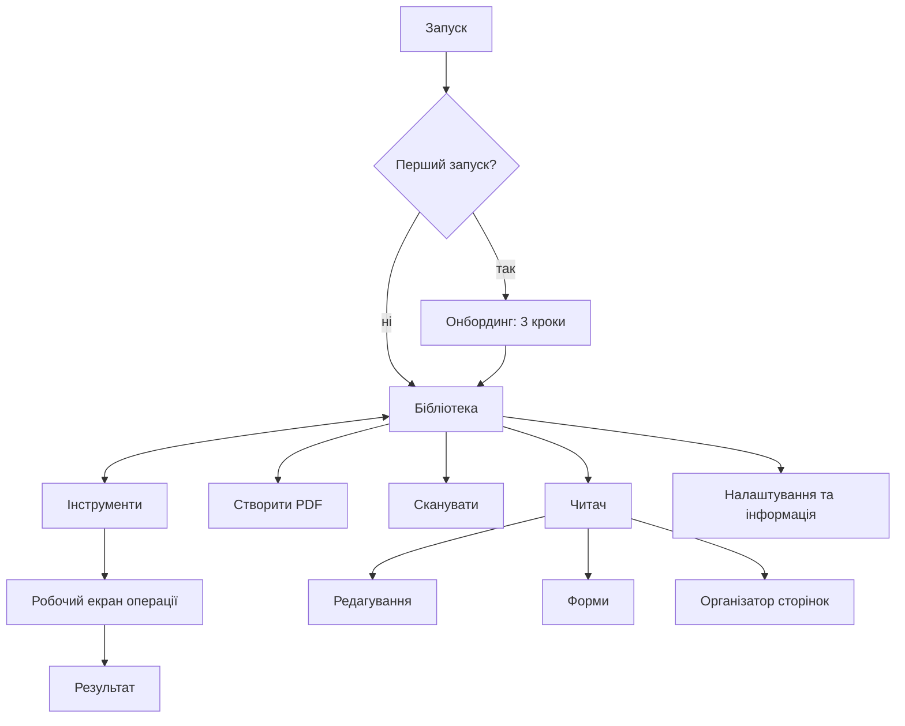

# Anti PDF — UX/UI redesign V2

> Статус: готова специфікація для реалізації після незалежної QA-перевірки.  
> Дата: 2026-11-23.  
> Обсяг: Android, XML Views + Material 3, без зміни PDF-ядра, дозволів, реклами чи моделі приватності.  
> Поточна збірка закритого тесту не змінюється цим документом.

## 1. Мета

Anti PDF має відчуватися не як набір технічних команд, а як спокійний інструмент для трьох зрозумілих завдань:

1. відкрити й прочитати PDF;
2. швидко заповнити або відредагувати документ;
3. виконати операцію зі сторінками й зберегти результат.

Головний принцип: **документ завжди важливіший за інтерфейс**. На кожному екрані є одна домінантна дія, другорядні команди згруповані за сенсом, а небезпечні або незворотні кроки мають підтвердження чи можливість скасування.

## 2. Незмінні продуктові рішення

- Назва в інтерфейсі: тільки **Anti PDF**.
- Матеріали користувача обробляються на пристрої; твердження про приватність мають залишатися точними.
- Навігація першого рівня: **Бібліотека** і **Інструменти**.
- Режим читання мінімалістичний; редагування починається лише після явної дії **Редагувати**.
- Реклама не перекриває документ, кнопку продовження або системні діалоги. Під час читання, редагування й збереження реклами немає.
- Редизайн не додає OCR, хмарну синхронізацію, AI-функції чи інші можливості, яких немає в продукті.
- Реалізація лишається на XML Views і Material 3; нова UI-бібліотека не потрібна.

## 3. Інформаційна архітектура



### Нижня навігація

- **Бібліотека** — останні документи, пошук, сортування, відкриття PDF.
- **Інструменти** — створення PDF та операції зі сторінками.
- Налаштування не стають третьою вкладкою: вони відкриваються з аватара/кнопки меню у верхній панелі.

## 4. Екрани

### 4.1 Онбординг

Три короткі сторінки без маркетингових перебільшень:

1. **Читайте без зайвого** — відкриття PDF через системний вибір файлу.
2. **Заповнюйте й підписуйте** — текст, позначки, малювання, підпис, AcroForm.
3. **Працюйте зі сторінками** — об’єднання, поділ, поворот, видалення, стискання.

Компоненти: ілюстрація, заголовок до двох рядків, опис до трьох рядків, індикатор сторінки, **Далі/Почати**, текстова кнопка **Пропустити**. Контент не має виходити за межі при масштабі шрифту 150%.

### 4.2 Бібліотека

Верхня панель:

- назва Anti PDF;
- пошук;
- фільтр/сортування;
- меню налаштувань.

Пункти пошуку, фільтра, сортування й очищення історії показуються **лише** на вкладці Бібліотека. На вкладці Інструменти toolbar містить назву розділу та загальні налаштування, без бібліотечних дій.

Основна зона:

- список недавніх документів із назвою, датою, кількістю сторінок (лише якщо дані відомі), ознакою обраного;
- порожній стан із дією **Відкрити PDF**;
- пошук замінює заголовок на поле й завжди має видиму кнопку закриття;
- фільтр і сортування відкривають одну нижню панель, а активний стан показується чипом над списком.

Головна дія — розширювана кнопка **Відкрити PDF**. Після натискання «+» доступні **Створити PDF** і **Сканувати**. Розкриті малі кнопки мають підписи, а не лише піктограми.

Рекламний банер займає зарезервовану зону між контентом і нижньою навігацією. Якщо реклами немає, порожня зона зникає без стрибка контенту після взаємодії.

### 4.3 Інструменти

Замість плоского списку з 11 рівнозначних карток — три групи:

- **Створити**: чистий PDF, сканувати документ, зображення у PDF;
- **Сторінки**: організувати, об’єднати, розділити, повернути, видалити;
- **Оформити й оптимізувати**: водяний знак, нумерація, стискання.

Кожен пункт — компактний рядок або плитка з піктограмою, назвою й одним коротким поясненням. Останні використані інструменти можуть підійматися в блок **Нещодавні**, але порядок усередині основних груп лишається стабільним.

### 4.4 Робочий екран операції

Усі інструменти використовують спільний каркас:

```text
← Назва операції                         Довідка
Крок 1 — Файли     Крок 2 — Параметри     Крок 3 — Зберегти
-----------------------------------------------------------
Вхідні файли / сторінки / параметри

[попередній перегляд або пояснення]

-----------------------------------------------------------
[Основна дія: Продовжити / Зберегти]
```

- Основна кнопка закріплена внизу й не перекривається клавіатурою.
- Валідація пояснює, чого бракує: наприклад, «Додайте щонайменше 2 PDF».
- Тривала операція показує назву кроку й індикатор; системна кнопка Назад не залишає «мертвий» екран.
- Результат має три дії: **Відкрити**, **Поділитися**, **Готово**. Міжсторінкова реклама можлива лише після успішного завершення і не перериває збереження.

### 4.5 Читач — режим перегляду

- Верхня панель: Назад, коротка назва файлу, Обране, меню.
- Документ займає максимум площі; панелі ховаються повторним дотиком і повертаються дотиком.
- Унизу — компактний чип номера сторінки/переходу й пошуку.
- Кнопка **Редагувати** плаває над документом і має текстовий підпис.
- Меню містить Поділитися, Друк, Відомості, Організувати сторінки та тему перегляду. Команди, що змінюють документ, не маскуються під читання.

### 4.6 Читач — режим редагування

Верхня панель явно показує стан:

- **Скасувати** — вихід із перевіркою незбережених змін;
- назва файла й індикатор **Не збережено**;
- **Зберегти** — домінантна дія.

Нижня панель має шість стабільних позицій, які поміщаються на ширині 360 dp без горизонтального прокручування:

1. **Текст**;
2. **Малювати**;
3. **Вставити** — ✓/✗, зображення, підпис;
4. **Вибрати**;
5. **Скасувати дію**;
6. **Ще** — повторити, параметри активного інструмента, видалення вибраного.

Повторний дотик до активного інструмента відкриває його параметри. Видалення не займає постійне місце: воно з’являється в контекстній панелі після вибору об’єкта. Повторити також доступно жестом/кнопкою в **Ще**, а при достатній ширині (ландшафт або планшет) показується окремо.

Контекст вибраного об’єкта — плаваюча панель біля об’єкта: редагувати, дублювати (якщо підтримано), видалити, додаткові параметри. Дії, яких фактично немає, не показуються.

### 4.7 Форми

- Вхід у форму відокремлений від розмітки.
- Нижня панель показує список полів, поточне поле й перехід Попереднє/Наступне.
- Обов’язкові незаповнені поля позначаються текстом та іконкою, не лише кольором.
- Перед виходом зі зміненими значеннями — Зберегти / Не зберігати / Залишитися.

### 4.8 Інструменти читача

Нижня панель групує фактичні 15 дій:

- **Додати**: сторінку, зображення, файл, скан;
- **Сторінки**: організувати, повернути, видалити, розділити, об’єднати;
- **Оформити й оптимізувати**: стискання, водяний знак, нумерація;
- **Експорт**: друк, поділитися;
- **Інформація**: відомості.

Це та сама термінологія й групування, що на вкладці Інструменти.

### 4.9 Організатор сторінок

- Сітка мініатюр із постійним номером сторінки.
- Режими: звичайний і множинний вибір.
- Перетягування має видимий «хват», а не покладається на довге натискання без підказки.
- Нижня контекстна панель: Повернути, Видалити, Дублювати (лише якщо підтримано), Готово.
- Після видалення показується **Скасувати**; спроба видалити всі сторінки блокується з поясненням.

### 4.10 Сканування

- Перед початком — коротке пояснення про системну камеру й локальне збереження.
- Після захоплення — список сторінок, зміна порядку, поворот, повторне сканування, назва файла.
- Дозвіл камери запитується лише в момент дії. Якщо системний сканер не доступний, є зрозумілий запасний шлях або повідомлення.

### 4.11 Налаштування та інформація

Окремий простий екран замість перевантаженого overflow-меню:

- **Вигляд**: тема системна/світла/темна, динамічні кольори;
- **Конфіденційність**: керування рекламною згодою, політика конфіденційності;
- **Про застосунок**: версія, ліцензії відкритого коду.

Для ліцензій слід зробити власні екрани список/деталі на базі наявних даних Google OSS. Це усуває відомий дефект, коли системний екран ліцензій заходить під статус-бар, і дає повний контроль над inset-ами та масштабом шрифту.

## 5. Дизайн-система

### 5.1 Кольори

Базовий характер — спокійний індиго, нейтральні поверхні й мінімум акцентів.

| Роль | Світла тема | Темна тема | Використання |
|---|---:|---:|---|
| Primary | `#3F51B5` | `#BBC3FF` | головні кнопки, активний стан |
| On primary | `#FFFFFF` | `#17245B` | текст/іконки на Primary |
| Background | `#F9F9FF` | `#111318` | фон екрана |
| Surface | `#FFFFFF` | `#191B20` | панелі, картки |
| Surface variant | `#E3E1EC` | `#44464F` | другорядні області |
| Error | `#BA1A1A` | `#FFB4AB` | помилки, підтверджене видалення |

Фінальні пари текст/фон перевіряються автоматизовано та вручну; мінімум — 4.5:1 для звичайного тексту і 3:1 для великого тексту та значущих графічних елементів. Динамічні кольори дозволені, якщо семантичні ролі та контраст збережено.

### 5.2 Типографіка

- Display не використовується в робочих екранах.
- Title Large — заголовок екрана; Title Medium — секції; Body Large — основний текст; Label Large — кнопки.
- Усі розміри задаються в `sp`; контейнер не має фіксованої висоти, якщо в ньому є текст.
- Назви файлів: максимум два рядки в списках, один рядок у toolbar з коректним скороченням посередині/в кінці.

### 5.3 Геометрія

- базова сітка 8 dp, локальний крок 4 dp;
- горизонтальні поля телефона 16 dp, планшета 24–32 dp;
- мінімальна ціль дотику 48×48 dp;
- радіуси: 12 dp для полів і малих карток, 16 dp для великих карток, 24–28 dp для нижніх панелей;
- elevation використовується лише для плаваючих та перекривних елементів.

### 5.4 Іконки й тексти

- Material Symbols/наявні векторні іконки, одна товщина штриха;
- кожна незнайома піктограма має текстовий підпис;
- одна дія — один термін у всьому застосунку: «Організувати сторінки», «Зберегти копію», «Стиснути PDF»;
- три крапки означають додаткові дії, а не головну команду.

### 5.5 Стани компонентів

Для кнопок, рядків, плиток і полів обов’язкові: default, pressed, focused, disabled, loading, error. Порожній стан завжди пояснює причину й пропонує одну дію. Skeleton застосовується лише там, де є реальне асинхронне завантаження; для локального короткого процесу достатньо індикатора.

## 6. Адаптивність та системні області

- Усі екрани edge-to-edge; системні відступи застосовуються до toolbar, bottom bar, модальних панелей та клавіатури централізовано.
- Ширина <600 dp: нижня навігація й одна колонка.
- 600–839 dp: navigation rail, дві колонки в Бібліотеці/Інструментах, обмеження ширини форм.
- ≥840 dp: rail + основна область; робочі операції можуть показувати параметри та прев’ю поруч.
- У ландшафті читача інструменти редагування можуть бути вертикальною рейкою з боку, щоб не зменшувати висоту документа.
- Жоден важливий елемент не покладається на виріз, статус-бар, gesture area чи сталу висоту системної панелі.

## 7. Доступність

- Порядок TalkBack відповідає візуальному порядку; декоративні елементи не озвучуються.
- Для іконок-дій є точні content descriptions з результатом дії, наприклад «Повернути сторінку праворуч».
- `MarkupOverlayView` має експонувати кожний редагований об’єкт як virtual accessibility node або через еквівалентний доступний список: назва, сторінка, selected state та дії редагування, видалення, переміщення і зміни розміру.
- Для drag, pinch, long-press, малювання та підпису потрібна кнопкова або інша доступна альтернатива; критична дія не може бути gesture-only.
- Speed dial і модальні поверхні тимчасово приховують фон від accessibility, переводять фокус усередину й повертають його на opener після закриття.
- Вибір, помилка, прогрес і незбережений стан не передаються лише кольором.
- Після відкриття модальної панелі фокус переходить на її заголовок; після закриття повертається на елемент-викликач.
- Зміна сторінки, завершення збереження й помилка мають ненав’язливе accessibility-оголошення.
- Підтримка масштабів шрифту 100%, 130%, 150% без обрізання ключових дій; 200% перевіряється для основних потоків.
- Анімації 150–250 мс і вимикаються/спрощуються, коли система просить зменшити рух.

## 8. Тексти й тон

Тон — короткий, конкретний, без звинувачення користувача.

| Ситуація | Рекомендований текст |
|---|---|
| Немає недавніх файлів | «Тут з’являться PDF, які ви відкривали» |
| Немає результатів | «Нічого не знайдено. Спробуйте іншу назву» |
| Файл захищений | «Цей PDF захищено. Введіть пароль, щоб продовжити» |
| Не можна редагувати | «Цей документ можна читати, але не змінювати» |
| Незбережені зміни | «Зберегти зміни перед виходом?» |
| Успішне збереження | «PDF збережено» |
| Операція не вдалася | «Не вдалося завершити дію. Оригінал не змінено» |

## 9. Що свідомо не входить у V2

- зміна PDF-ядра або форматів збереження;
- нові дозволи Android;
- хмарне сховище, обліковий запис, телеметрія;
- OCR, редагування існуючого текстового шару, AI;
- зміна рекламних розміщень, частоти чи бойових ідентифікаторів;
- публікація або оновлення поточної закритої тестової версії.

## 10. Ознака успіху

Редизайн успішний, якщо новий користувач без інструкції може відкрити PDF, перейти в редагування, додати текст, зберегти копію та знайти інструмент роботи зі сторінками; при цьому досвідчений користувач не втрачає жодної наявної функції, а інтерфейс проходить матрицю з `REDESIGN_ACCEPTANCE_CRITERIA.md`.
